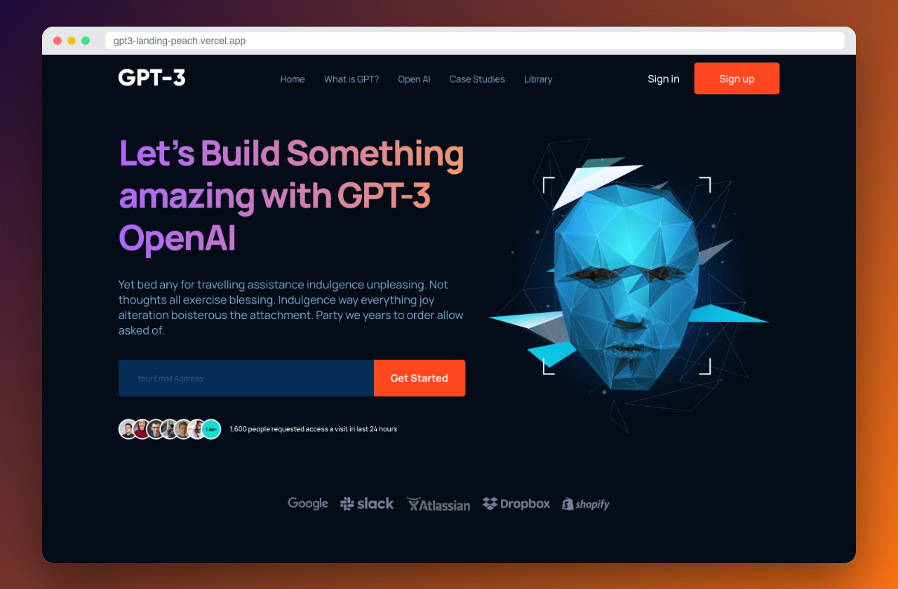

# GPT-3 Landing Page

A responsive marketing landing page for an AI product. Built in React with component-scoped Sass from a Figma design.

**[Live demo](https://gpt3-landing-peach.vercel.app)**



  

## Highlights

- Figma-to-code implementation with gradient text, a glassy CTA and a brand strip
- BEM-style Sass modules for each section (header, features, blog, CTA, footer)
- Mobile-first responsive layout with a hamburger menu
- Deployed on Vercel

## Getting started

```bash
git clone https://github.com/srg201/gpt3-landing.git
cd gpt3-landing
npm install
npm start
```

## Author

**Siarhei Beliakou** · Full Stack Developer (React, Next.js, NestJS)
[GitHub](https://github.com/srg201) · [LinkedIn](https://linkedin.com/in/sergey-belyakov-1b7641349) · belyakov329@gmail.com

Open to freelance and full-time work.
